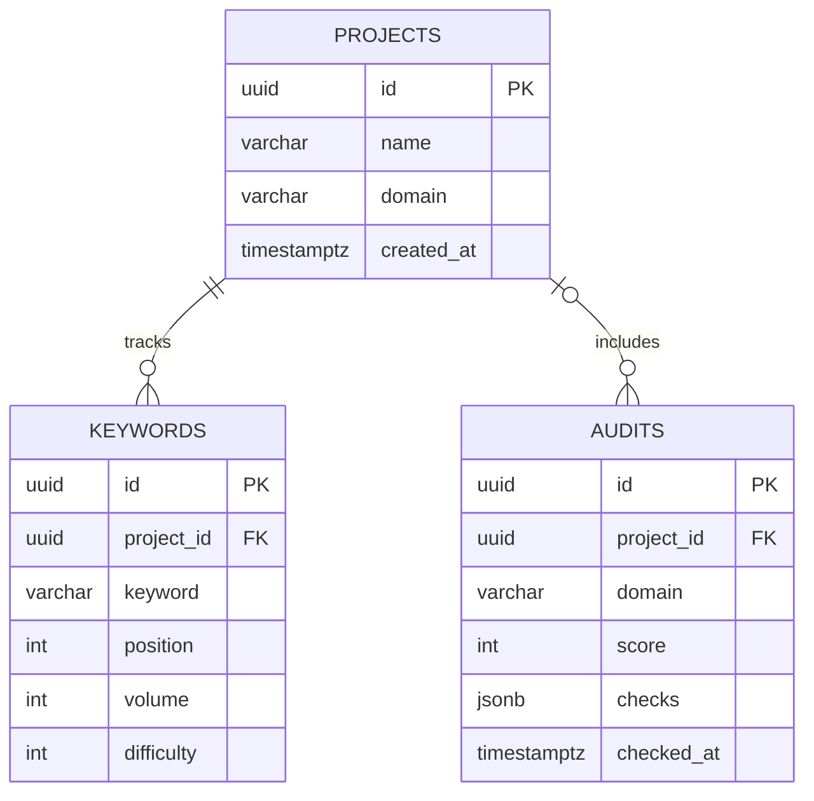

# SearchPilot — implementation and expansion architecture

## Stack and responsibilities

Next.js App Router + TypeScript + Tailwind CSS for the user interface. Route handlers under `app/api` for the backend. PostgreSQL 17 via `pg` for durable records. Docker Compose provides local database only.

| Area | Data source | What works today | Expansion |
| --- | --- | --- | --- |
| Workspaces | PostgreSQL | Create/list projects; seeded illustrative demo when no DB | users and memberships |
| Keywords | PostgreSQL | Add/remove/list custom keywords and manually supplied metrics | Search Console and licensed keyword provider |
| Site auditing | Public URL HTML read on request | HTTPS, title, description, H1, canonical, viewport | rate-limited queue, robots policies, bounded crawl and history comparisons |
| Domain / backlinks overview | Synthetic demo figures | UX exploration only | independent paid data index or licensed provider |
| Position tracking | User-entered rank values | show tracked entries | authorized Search Console observations / independent rank provider |
| Reports | UI | representative summary | data-bound exports, scheduled reports |

## HTTP API

- `GET /api/projects` → `{ projects, demo }`
- `POST /api/projects` with `{ name, domain }` → `{ project }`
- `GET /api/keywords?projectId=<uuid>` → `{ keywords, demo }`
- `POST /api/keywords` with `{ projectId, keyword, position?, volume?, difficulty? }` → `{ keyword }`
- `DELETE /api/keywords?id=<uuid>` → `{ deleted }`
- `GET /api/audit?projectId=<uuid>` → `{ audits, demo }`
- `POST /api/audit` with `{ domain, projectId? }` → `{ audit, persisted }`

Requests return JSON errors as `{ error }`. Without `DATABASE_URL`, demo reads work and database writes return an explicit error; one-off audits can run without persistence. The audit endpoint resolves DNS to filter private ranges, disallows redirects, and uses an eight-second timeout. For public production use, add authentication, DNS pinning/network egress controls, crawl quotas and rate limiting before allowing arbitrary URLs.

## Database relationships

## Build phases

1. **Foundation (implemented):** app shell, responsive navigation, demo reports, PostgreSQL and JSON routes.
2. **Meaningful SEO measurement (partially implemented):** on-demand homepage technical audit, manually tracked keywords, persisted projects.
3. **Live authorized analytics:** OAuth to Search Console, keyword impressions/clicks/positions, user accounts, separate tenant workspaces.
4. **Crawler and workflow:** bounded queue, robots compliance, issue history, notifications, task management, report export.
5. **Advanced SEO research:** independently licensed backlink/keyword indexes, competitor gap and multi-location rank history.

## Data integrity

All invented numbers must remain clearly marked **demo/sample**. No platform may infer organic traffic, keyword volume, rank history or backlinks from one HTML request. A homepage audit is a lightweight first-pass check, not a comprehensive crawl.
