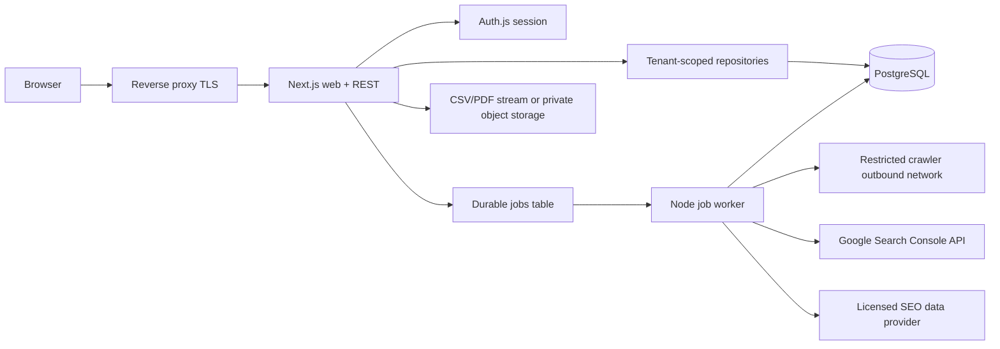

# SearchPilot architecture — implementation blueprint

**Version:** 2026-10-13; **status:** proposed target architecture, not an assertion that it is implemented. **Source:** [recon](recon.md), [feature matrix](features.csv), existing [API](../app/api) and [database](../db/schema.sql). Semrush publicly documented workflows are inspiration for independently built features; no private APIs or copied datasets.

## Current implementation and compatibility

The existing app is **Next.js 15 App Router, React 19, TypeScript, Tailwind 3, PostgreSQL 17, `pg`**. Pages: `/`, `/projects`, `/domain-overview`, `/keywords`, `/position-tracking`, `/site-audit`, `/backlinks`, `/reports`, `/onboarding`. Live route handlers: `GET/POST /api/projects`, `GET/POST/DELETE /api/keywords`, `GET/POST /api/audit`. Only `projects(id,name,domain,created_at)`, `keywords(id,project_id,keyword,position,volume,difficulty,created_at)`, `audits(id,project_id nullable,domain,score,checks jsonb,checked_at)` persist. With no `DATABASE_URL`, GET endpoints return **demo data** and writes except one-off audits require PostgreSQL. The current audit checks one public HTTPS homepage; it does not crawl a site or measure Google positions. Keep current code and `db/schema.sql` operational until migration and route cutover.

**Critical deployment gate:** Existing routes have no authentication or tenant authorization; `GET /api/keywords` and `GET /api/audit` allow unscoped listing and current mutation routes trust client-supplied project IDs. They must be gated or disabled before internet exposure. Current audit DNS validation is not a sufficient production SSRF boundary because DNS can rebind and egress can change. Never represent the existing MVP as publicly safe for multi-tenant use.

## Stack decisions

| Layer | Choice | Reason |
| --- | --- | --- |
| Web | Next.js App Router, React, TypeScript | preserve existing working code and route handlers |
| UI | Tailwind CSS and original SearchPilot design tokens | consistent responsive components without Semrush assets |
| API | Next.js Node.js route handlers, typed input schemas using Zod | same-origin REST and validation; no separate API service |
| Primary DB | PostgreSQL 17, one database | relational integrity and cost-effective historical measurements |
| Queries/migrations | Retain `pg` for compatibility; use versioned SQL migrations, typed repository functions | reversible evolution of existing raw SQL, no ORM rewrite required |
| Auth | Auth.js with OIDC (Google) or trusted passwordless email login | proven session management and future GSC consent separation |
| Authorization | explicit workspace membership checks in the repository plus PostgreSQL RLS in the **target greenfield schema** | defense in depth; current production bootstrap has neither and must be migrated |
| Queue/jobs | PostgreSQL `jobs` table with `FOR UPDATE SKIP LOCKED` and a dedicated Node worker in same codebase | one durable datastore, simple Docker deployment; idempotent leases/retries |
| Audit fetch | queue-driven restricted HTTP worker with egress firewall and DNS pinning | guard outbound crawling and avoid request timeouts |
| Search integrations | official Google Search Console API with OAuth and user-authorized properties | first-party clicks/impressions/CTR/average positions |
| Keyword/backlink intelligence | optional licensed third-party providers behind a provenance adapter | GSC cannot provide worldwide keyword volumes or backlink index |
| File exports | temporary generated PDFs/CSVs; add S3-compatible storage only when scheduled reports need durable objects | avoid premature file infrastructure |
| Email | transactional provider such as Resend or Postmark | invites, recovery, report delivery |
| Deployment | Docker Compose: Next.js web + worker + PostgreSQL behind Caddy or Nginx TLS proxy | user's specified Docker/reverse-proxy path, no microservices |
| Observability | structured JSON logs, per-job metrics, error monitoring | trace async scans and provider failures |

No payments in initial SEO roadmap. If paid plans are added later, store integer price cents and ISO currency with Stripe-hosted billing; payment events must be idempotent.

## Logical components and trust boundaries

**Trust boundary:** Proxy applies TLS, origin/body limits and request rate limits. Every API call authenticates user identity, resolves workspace membership and checks role, then issues a parameterized query constrained by `workspace_id`. The **target schema** adds PostgreSQL RLS as a second barrier; each authenticated transaction must set verified `app.user_id` with `SET LOCAL`, using a non-owner login role inheriting `searchpilot_app`, never superuser/BYPASSRLS. Workspace ownership and membership changes also require trusted server-side checks. Worker uses separately restricted job permissions; `workspace_id` is carried through results, checkpoints, quotas, caches and logs. Separate OAuth connection credentials are encrypted at rest, never passed to the browser except status/metadata. Queue consumers cannot bypass URL/egress policy.

**Role policy:** owner may transfer ownership (with explicit verification), manage/delete workspace and memberships; editor may create/update tracked keywords, audit campaigns, reports and integrations if granted integration permission; viewer may read allowed reports and export according to workspace policy, never mutate. Explicit denial returns 403; unknown workspace returns 404 to avoid enumeration. Only owner/editor can run budgeted jobs. Membership is verified for *every* read and write, including joins, exports and background-job status. Query a single tenant before joining facts; never filter after retrieval. Prefer composite FK `(workspace_id, parent_id)` to prevent accidental cross-tenant relations. Sensitive provider tokens live in a separate restricted credential table; never return token fields.

## Schema strategy

See [schema.sql](schema.sql) for the proposed **greenfield normalized target schema**; it is deliberately separate from the bootstrapped `db/schema.sql`. It must **not** be applied directly over the current database. Migration approach: (1) add users/workspaces/memberships and compatibility mapping, (2) create a default workspace for each authorized imported project and backfill owner, (3) dual read/rename API behind a feature flag, (4) move current `keywords` to workspace-scoped tracked terms and `audits` to audit runs/results with explicit provenance, (5) add access controls and validate isolation, (6) retire legacy unscoped endpoints. Create migration-up/migration-down pairs with backups and dry run; do not blindly rename or drop existing tables.

Data-model rules: UUID keys, UTC `timestamptz`, `created_at`/`updated_at`, explicit `ON DELETE` semantics, unique normalized domain/keyword keys inside a workspace, nonnegative counts and bounded health score, rank `NULL` for unranked, one observation per `(tracked_keyword, target, observation_date, provider)` with conflict upsert, URLs stored normalized and length-bounded, index foreign keys and common date filters. Historical observations are immutable after ingest except documented provider corrections. Every metric has provider, observed/collected timestamps and source/provenance (`live`, `licensed`, `manual`, `demo`). Never blend synthetic and live figures into one KPI.

## Crawling and site auditing

1. API checks authenticated editor membership, URL/domain ownership/policy and quotas; creates an audit run and durable job transactionally; returns `202` with job/run IDs.
2. Worker claims next queued job via `FOR UPDATE SKIP LOCKED`, stores lease, attempt count and heartbeat, and releases the lease after completion or controlled retry. Jobs use an idempotency key and unique logical run identifier.
3. Fetcher accepts only HTTPS/HTTP on approved ports (prefer HTTPS); reject credentials, IP literal targets, localhost, internal/reserved/cloud-metadata networks, DNS rebinding, alternate numeric IP encodings, redirect hops to unauthorized hosts, TLS bypass and decompression bombs. Resolve and pin a public address at the network layer, revalidate every redirect/hop, apply egress firewall/proxy deny rules. Restrict cross-domain hops unless explicitly allowed.
4. Respect applicable robots rules, origin rate limits, per-domain concurrency and crawl-delay policy; use bounded page count, depth, bytes/response, cumulative bytes, hop count, wall time and total URLs. Normalize URL fragments, query parameters and canonical links. Do not bypass authentication/paywalls.
5. Persist per-page fetch response and findings; compute health score from **documented SearchPilot rules**, not Semrush's undisclosed score. Capture failures honestly. Make rule version and crawl timestamps available.
6. Compare two finished runs by normalized page URL + rule ID for new, persisting and resolved issues. Only mark a run complete after all page results are durably written. Provide job cancel/retry with quotas.

Live simple `/api/audit` remains demo/MVP compatibility until replacement; it is **not** the worker-based crawler. Never run unbounded crawls inside request handlers.

## Keyword research and rank history

One workspace owns keyword lists and tracking campaigns. A tracking campaign has a site target, engine, device, country/region, locale and time zone. The normalized dictionary of keyword phrases is separate from per-workspace tracked terms and observations. Persist daily snapshots with **observation date in the target's locale** and precise `collected_at timestamptz`; support rank `NULL` and explicit `unranked` state. Track organic result URLs and SERP features only when the source provides them. Comparisons use aligned dates and matching campaign scope, never data from dissimilar markets. Bulk insert with uniqueness/upsert keyed by campaign, tracked term, observation date and provider. Apply sensible retention/partitioning as volume grows. GSC average position is an aggregate measurement: **do not label it as an exact daily SERP rank**.

Keyword research, global search volumes, difficulty, competitor comparisons, backlink discovery and historical SERPs need independently licensed datasets; do not invent results from Google Search Console or scrape Semrush.

## Google Search Console (GSC)

Use Google's official OAuth flow with limited `webmasters.readonly` scope, PKCE/state and CSRF protection, and exact redirect URI. OAuth's identity/session login and GSC property access are distinct. Store encrypted refresh tokens server-side (envelope key outside DB), restrict credential access by workspace, rotate/revoke and support disconnect. List accessible Search Console properties, require an explicit selection and verify permissions on each import. Queue imports per `(workspace, property, date range, search type, dimensions)` with rate budgets; collect clicks, impressions, CTR and average position and store complete dimension tuples (query/page/country/device/date). Respect GSC row limits, pagination, anonymized/suppressed queries, changing totals and API quotas; use overlapping recent-day backfills to cover delayed data. Record API source, property, extraction time, date range and completeness. Show no-data where Google omits records. No Semrush API involved.

## Jobs, events and operational requirements

| Task | Schedule/trigger | Idempotency and safeguards |
| --- | --- | --- |
| Crawl | user request or daily/weekly scheduled slot | workspace quota, unique run key, per-domain lock and retry budget |
| Rank provider sync | daily per campaign target timezone | unique observation key and provider quotas |
| GSC incremental sync | daily plus first-connection backfill | checkpoint cursor, overlapping re-fetch, grant validation |
| Provider token maintenance | before expiry/on access | encrypted refresh and per-connection lock |
| Report rendering/delivery | explicit user action or schedule | snapshot metadata, unique delivery key, retry-safe email |
| Stale-job recovery | every 5 minutes | lease expiry, bounded attempts, dead-letter state |
| Data retention/purge | daily | workspace-scope deletion policy and audited erase |

**Inbound webhooks:** none required for GSC polling; optionally process email delivery status and Stripe events only if providers are added. Verify signatures and persist event IDs before side effects. **Outbound webhooks:** not necessary at MVP; if added, signed payloads, bounded retries and allowlisted endpoints.

**Performance/security minimums:** pagination (default 25, max 100), database indexes on workspace/date, keyset pagination for large observations, short read queries and connection pool caps, CDN/browser cache only for nonprivate/static content, tenant-safe cache keys, queue backpressure, origin rate limit + per-user/domain quotas, body size limits, secure HTTP-only SameSite cookies, CSRF protections, strong CSP/HSTS, secrets via environment/secret store, TLS, automatic migrations with backups, continuous vulnerability scanning, health probes, basic telemetry and restore drills. Encrypt external tokens; minimize logged URLs/query data where necessary and support account export/deletion and reasonable retention (GDPR where applicable). No offline write workflow assumed. Use UTC storage and explicit timezone/DST conversion for schedules; recurrences run once on local dates even across DST. Use idempotency on mutating/job-creation requests; uniqueness constraints handle races.

## Architecture decision log

- **ADR-01** Preserve existing raw SQL and API contracts while designing versioned tenant-safe `/api/v1` endpoints.
- **ADR-02** One PostgreSQL DB with explicit data-layer authorization; the new schema adds RLS defense-in-depth. The current legacy schema has no RLS or authorization and must not be treated as tenant-ready.
- **ADR-03** Dedicated worker process in same repository, with DB-backed queues; deploy web and worker as separate Compose processes, not separate products.
- **ADR-04** GSC for owned-property search analytics; third-party SEO market intelligence is optional and licensed.
- **ADR-05** Research screenshots in `replica/screens/` are development-only and must never ship as product assets.

Implementation sequence and acceptance gates: [implementation-plan.md](implementation-plan.md). Endpoint contracts: [api-spec.md](api-spec.md). Next skill: `/replica-design` after approving the first authenticated vertical slice.
